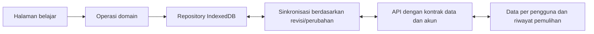

# Analisis Ruang Belajar untuk aplikasi publik

Tanggal: 22 Oktober 2026, Asia/Singapore. Tujuan produk dikonfirmasi pengguna: aplikasi publik untuk banyak pengguna, dengan workspace pribadi per akun.

## Kesimpulan

Fitur pencatatan sudah luas: agenda, tracker, timer, tugas, kalender, statistik, tryout, akun, migrasi, dan enam bahasa. Kekurangan paling penting berada pada ketahanan penyimpanan, efisiensi sinkronisasi, pembuktian database/operasional produksi, serta hubungan antara rencana belajar dan hasilnya.

Saya belum merekomendasikan rilis publik luas sebelum kontrak kapasitas data dan pengujian Supabase nyata diselesaikan. Hal ini merupakan penilaian kesiapan berdasarkan kode dan eksperimen lokal, bukan hasil uji penetrasi atau pengukuran kapasitas produksi.

Prioritas yang dipakai:

- **Gerbang rilis:** harus terbukti sebelum membuka pendaftaran publik secara luas.
- **P1:** fondasi atau fitur yang sebaiknya menjadi iterasi pertama.
- **P2:** peningkatan berikutnya setelah fondasi dan alur harian stabil.

Analisis ini menghasilkan laporan dan probe sintetis. Kode aplikasi, SQL produksi, akun, serta data belajar pengguna tidak diubah.

## Bukti dan batas pemeriksaan

- Menelusuri modul aktif `study/`, kedua API, skema SQL, konfigurasi server/deployment, migrasi, dan pengujian. Modul lama di root dibedakan dari entry point aktif.
- `npm test` dijalankan kembali setelah penghapusan Sela: **15 suite lulus**, termasuk migrasi, konflik, isolasi akun, cadangan besar, dan stress tujuh zona waktu. Folder Sela tidak diperlukan oleh suite tersebut.
- Probe baru memakai Edge headless **155.0.4283.62**, origin terisolasi pada port 5204, serta data sintetis. Probe mengukur penulisan bentuk cache akun yang sama dengan implementasi dan memeriksa perilaku model/renderer.
- Hasil tersimpan pada [evidence JSON](C:/Users/camar/Documents/Coding/ruang-belajar/docs/analysis/2026-10-22-public-readiness-evidence.json); [kode probe](C:/Users/camar/Documents/Coding/ruang-belajar/docs/analysis/public-readiness-probe.mjs) dapat dijalankan ulang dari root repo dengan `node docs/analysis/public-readiness-probe.mjs <path-ke-playwright/index.mjs>`. Memerlukan Edge dan Playwright yang tersedia pada mesin penguji.
- Konfigurasi Vercel/Supabase Dashboard, SMTP, penerapan SQL, backup provider, serta trafik produksi **tidak diperiksa langsung**. Ketiadaan konfigurasi di repo tidak membuktikan bahwa pengaturan dashboard juga tidak ada. Status terakhir dari percakapan adalah penerapan SQL ditunda.
- Referensi platform lain diperiksa melalui dokumentasi dan repositori resmi. Yang dibandingkan adalah kemampuan dan pola sistem; tidak ada kode platform lain yang disalin.

## Yang sudah patut dipertahankan

1. Pemisahan data akun/tamu, pemeriksaan identitas tujuan, cookie HttpOnly, dan pengamanan origin sudah ada. Skema menulis RLS per pemilik; pembuktian RLS nyata masih diperlukan.
2. Model waktu membedakan sesi dan interval jeda, menangani pergantian hari, serta menolak interval tumpang tindih.
3. Sinkronisasi sudah memiliki revisi, penggabungan tiga arah, backoff, cache offline, serta pilihan konflik dengan ekspor kedua versi.
4. Migrasi menjaga sumber, memetakan ID bentrok, menyediakan pratinjau, dan mencadangkan sebelum penggantian/penggabungan.
5. Fungsi domain dan mesin sinkronisasi cukup terpisah untuk diuji. Peningkatan tidak mensyaratkan penggantian framework frontend.

## Sistem yang kurang atau belum terbukti

### S1. Kapasitas penyimpanan belum konsisten sepanjang alur — gerbang rilis

**Temuan terukur.** Skema menerima 100.000 interval dan impor sampai 128 MiB. Cache akun menyimpan dokumen aktif bersama salinan `base`; IndexedDB saat ini hanya dipakai untuk mutex, bukan penyimpanan data.

| Interval sintetis | Dokumen | Cache dengan base, UTF-8 | Request melewati 4 MiB? | Penulisan cache di Edge |
| --- | ---: | ---: | --- | --- |
| 1.000 | 0,199 MiB | 0,399 MiB | Tidak | Berhasil |
| 10.000 | 1,959 MiB | 3,918 MiB | Tidak | Berhasil |
| 20.000 | 3,914 MiB | 7,828 MiB | Tidak | `QuotaExceededError` |
| 30.000 | 5,869 MiB | 11,738 MiB | Ya | `QuotaExceededError` |
| 100.000 | 19,554 MiB | 39,109 MiB | Ya | `QuotaExceededError` |

Contoh 20.000 interval valid menurut skema dan masih di bawah batas request API, tetapi cache akun gagal ditulis. Contoh 30.000 interval sudah melampaui batas sinkronisasi. Batas tepat berubah menurut panjang ID, konteks, teks, browser, dan data lain pada origin yang sama; tabel ini bukan angka universal untuk semua pengguna.

Penanganan kuota sudah ada dan meminta ekspor, tetapi kapasitas yang diterima oleh parser belum menjamin data dapat disimpan permanen atau dipakai lintas perangkat. Penyimpanan beberapa akun pada satu browser menambah tekanan kuota. Keterbatasan Web Storage juga dijelaskan dalam [dokumentasi kuota MDN](https://developer.mozilla.org/en-US/docs/Web/API/Storage_API/Storage_quotas_and_eviction_criteria).

**Saran:** gunakan IndexedDB untuk workspace/cache dan riwayat. Tambahkan pemeriksaan kapasitas sebelum menerapkan impor, batas yang konsisten pada UI/API/database, serta pengujian simpan–reload–sinkronisasi pada batas tersebut. Impor yang melampaui kapasitas perlu ditolak secara jelas dengan sumber tetap tersedia. Jangan memotong riwayat diam-diam.

Bukti: [penulisan cache](C:/Users/camar/Documents/Coding/ruang-belajar/study/sync.mjs:145), [batas skema](C:/Users/camar/Documents/Coding/ruang-belajar/study/core.mjs:7), [batas API](C:/Users/camar/Documents/Coding/ruang-belajar/api/workspace.js:40), [fungsi IndexedDB](C:/Users/camar/Documents/Coding/ruang-belajar/study/storage.mjs:2).

### S2. Sinkronisasi membaca seluruh workspace secara berkala — P1

`flush()` membaca dokumen remote sebelum rekonsiliasi. Halaman yang terlihat memanggilnya setiap 10 detik, walaupun tidak ada perubahan. Satu perubahan kecil juga menyimpan ulang dokumen lengkap. Pemisahan per akun sudah ada; persoalannya adalah biaya kerja dan transfer per workspace yang bertambah besar.

Pada contoh 10.000 interval, payload dokumen sekitar 1,959 MiB. Jika dikirim penuh setiap 10 detik selama satu jam, hitungan JSON mentahnya sekitar **705 MiB per tab aktif per jam**. Ini estimasi sebelum kompresi, tanpa header, jeda, atau cache jaringan; bukan pengukuran bandwidth produksi. Volume request dan pemrosesan tetap perlu diperhatikan meskipun kompresi menurunkan byte transfer.

**Saran bertahap:** periksa revisi kecil lebih dahulu dan ambil dokumen hanya saat berubah; koordinasikan polling antar-tab. Untuk riwayat panjang, pisahkan interval/tugas sebagai record dengan pagination atau protokol perubahan. Pertahankan pemeriksaan akun, penggabungan konflik, serta penghapusan yang konsisten.

Bukti: [read dalam flush](C:/Users/camar/Documents/Coding/ruang-belajar/study/sync.mjs:293), [polling](C:/Users/camar/Documents/Coding/ruang-belajar/study/app.mjs:1808), [query seluruh JSON](C:/Users/camar/Documents/Coding/ruang-belajar/api/workspace.js:63).

### S3. Validasi dan revisi belum menjadi kontrak database yang menyeluruh — gerbang rilis

SQL memberi `authenticated` hak `insert/update` langsung pada tabel miliknya. RPC memakai `security invoker`. Validasi ukuran/struktur lengkap berada di API aplikasi; pemeriksaan RPC hanya mencakup versi dan bentuk objek akademik secara minimal.

Akibatnya, dari definisi SQL, klien terautentikasi dapat menggunakan Data API untuk menulis barisnya sendiri melalui jalur lain, tanpa melewati validasi API aplikasi atau pemeriksaan revisi RPC. Ini **bukan bukti akses lintas akun**: RLS tetap ditulis untuk membatasi pemilik. Kekurangannya adalah konsistensi kontrak data, batas per pengguna, dan perlindungan sumber daya pada aplikasi publik.

**Saran:** putuskan jalur penulisan resmi, tegakkan batas ukuran/skema/revisi pada database, lalu uji jalur langsung dan RPC. Jangan sekadar mencabut grant karena RPC `security invoker` juga bergantung pada izin tabel. Perubahan hak akses membutuhkan desain fungsi dan pengujian bersama. [Panduan RLS Supabase](https://supabase.com/docs/guides/database/postgres/row-level-security) menjelaskan hubungan grant, policy, dan pengujian allow/deny.

Bukti: [grant tabel dan RPC](C:/Users/camar/Documents/Coding/ruang-belajar/supabase-schema.sql:17), [validasi minimal RPC](C:/Users/camar/Documents/Coding/ruang-belajar/supabase-schema.sql:25), [validator API](C:/Users/camar/Documents/Coding/ruang-belajar/api/workspace.js:69).

### S4. Belum ada pembuktian integrasi database dan proses rilis otomatis — gerbang rilis

Tes API/sync memakai upstream tiruan. Repo tidak memiliki `supabase/migrations`, `supabase/tests`, atau workflow `.github`. SQL manual tersedia, tetapi belum ada rangkaian migrasi dan tes database nyata dalam proyek ini. Tes browser memakai instalasi Playwright eksternal dan beberapa suite mengunci kanal Edge, sehingga lingkungan CI belum dapat direproduksi hanya melalui `npm ci`.

**Saran:** gunakan migrasi bernomor dan lingkungan staging. CI perlu menjalankan unit test, pemeriksaan format, browser test dengan dependency yang terkunci, serta tes Postgres/RLS. Uji dua akun, anon, penolakan akses silang, race revisi awal/lanjutan, batas data, dan pemulihan. Supabase menyediakan [pengujian database dengan pgTAP](https://supabase.com/docs/guides/local-development/testing/overview).

Tes yang sudah lulus bernilai untuk logika yang dicakupnya. Masih diperlukan bukti bahwa SQL, grant, RLS, cookie, provider Auth, dan konfigurasi deployment bekerja bersama.

Bukti: [fixture API](C:/Users/camar/Documents/Coding/ruang-belajar/tests/api.test.mjs:16), [runner tes](C:/Users/camar/Documents/Coding/ruang-belajar/tests/run.mjs:2), [dependency proyek](C:/Users/camar/Documents/Coding/ruang-belajar/package.json:5).

### S5. Pemulihan baru berupa snapshot saat operasi tertentu — P1

Ekspor JSON dan cadangan sebelum impor/konflik sudah ada. Tabel cloud menyimpan versi terakhir; angka revisi tidak menyimpan isi versi lama. Penghapusan tugas/tryout langsung membuang record dari workspace setelah konfirmasi. Belum ada tempat sampah, undo yang bertahan setelah reload, atau daftar snapshot historis pengguna.

**Saran:** mulai dari tempat sampah atau undo untuk penghapusan dan snapshot sebelum operasi besar. Tambahkan kebijakan retensi, pemulihan per akun, dan uji pemulihan yang menghasilkan data utuh. Status backup provider belum diperiksa dan perlu diuji terpisah. Sebagai referensi, Anki memiliki backup periodik dan retensi harian/mingguan/bulanan dalam [sistem backup-nya](https://docs.ankiweb.net/manual/backups).

Bukti: [hapus tugas](C:/Users/camar/Documents/Coding/ruang-belajar/study/app.mjs:1185), [hapus tryout](C:/Users/camar/Documents/Coding/ruang-belajar/study/academic-ui.mjs:250), [tabel versi terakhir](C:/Users/camar/Documents/Coding/ruang-belajar/supabase-schema.sql:3).

### S6. Operasional Auth publik belum lengkap dalam kode — gerbang rilis

Daftar, masuk, verifikasi, reset, dan keluar sudah ada. API menangani respons rate limit dari provider, tetapi belum ada limiter aplikasi atau alur token CAPTCHA pada frontend/transport server. Pengaturan proteksi di dashboard belum diperiksa. Mengaktifkan CAPTCHA provider juga membutuhkan perubahan frontend dan pengiriman token, sebagaimana dijelaskan [Supabase CAPTCHA](https://supabase.com/docs/guides/auth/auth-captcha).

**Saran:** tentukan rate limit per endpoint dan strategi proteksi bot untuk daftar/reset, uji CAPTCHA bila digunakan, dan verifikasi SMTP, resend, recovery, serta redirect domain produksi dengan akun uji. [Panduan rate limiting Vercel](https://vercel.com/kb/guide/add-rate-limiting-vercel) dapat menjadi referensi implementasi edge; konfigurasi aktual tetap perlu diuji.

Bukti: [payload pendaftaran](C:/Users/camar/Documents/Coding/ruang-belajar/api/auth.js:257), [reset](C:/Users/camar/Documents/Coding/ruang-belajar/api/auth.js:302), [form akun](C:/Users/camar/Documents/Coding/ruang-belajar/study/app.mjs:601).

### S7. Siklus hidup akun dan data perangkat belum lengkap — P1

Ekspor data dan logout tersedia. Belum ada UI untuk hapus akun/data cloud, menghapus cache akun pada perangkat, atau mencabut sesi perangkat lain. Logout sengaja mempertahankan cache agar pekerjaan tertunda dapat dipulihkan. Untuk perangkat bersama, perlu pilihan yang jelas bagi pengguna.

**Saran:** sediakan “keluar dan hapus data perangkat” dengan perlindungan perubahan yang belum tersinkron; bedakan dari penghapusan akun/cloud. Tambahkan alur hapus akun dengan autentikasi ulang serta kebijakan retensi yang dijelaskan kepada pengguna. Server dapat mengirim peringatan jika revokasi logout gagal, tetapi transport sekarang mengabaikan payload peringatan itu; status lokal dan revokasi provider perlu dikomunikasikan dengan tepat.

Bukti: [logout klien](C:/Users/camar/Documents/Coding/ruang-belajar/study/cloud.mjs:118), [peringatan server](C:/Users/camar/Documents/Coding/ruang-belajar/api/auth.js:380). Bagian ini menilai kendali data dalam produk, bukan kepatuhan hukum.

### S8. Belum ada versi katalog dan migrasi konten — P1

ID topik/sesi tervalidasi terhadap katalog yang sedang dibundel. Katalog dan UI menggunakan 84 sesi, 116 topik, dan 348 tahap; sebagian total ditulis sebagai konstanta di UI. `version: 3` adalah versi workspace, belum membedakan versi kurikulum/katalog. Probe mengonfirmasi bahwa ID topik yang tidak ada dalam katalog ditolak sebagai format cadangan tidak valid.

Jika topik lama dihapus atau ID diganti pada pembaruan mendatang, workspace lama dapat gagal dibaca tanpa migrasi. Penambahan topik juga perlu mempertimbangkan klien lama yang masih terbuka. Metadata sumber saat ini menyebut 2026, sedangkan produk ditujukan untuk persiapan 2027; ini tidak otomatis berarti materinya salah, tetapi memerlukan proses pemeriksaan dan pembaruan sumber.

**Saran:** pisahkan versi schema dan katalog, gunakan ID stabil, simpan pemetaan/arsip ID lama, turunkan total dari data, dan uji upgrade/downgrade klien. Tambahkan asal sumber, tanggal pemeriksaan, serta cara memperbarui referensi yang berubah.

Bukti: [ID katalog](C:/Users/camar/Documents/Coding/ruang-belajar/study/academic-model.mjs:7), [penolakan topik tak dikenal](C:/Users/camar/Documents/Coding/ruang-belajar/study/academic-model.mjs:71), [angka UI](C:/Users/camar/Documents/Coding/ruang-belajar/study/academic-ui.mjs:125).

### S9. Pemantauan kegagalan dan bantuan publik belum terbentuk — P1

Pesan kesalahan lokal dan status sinkronisasi sudah tersedia. Belum ada jalur pelaporan error terstruktur, request ID, versi aplikasi pada laporan masalah, metrik kegagalan sync, atau runbook pemulihan yang terhubung ke operasi aplikasi. Pemeriksaan dashboard monitoring provider belum dilakukan.

Pesan `http.workspace` meminta pembaca memeriksa pemasangan SQL. Ini berguna untuk pengelola, tetapi pengguna publik membutuhkan status penyimpanan yang akurat, tindakan coba lagi/ekspor, dan kode dukungan. Detail konfigurasi server sebaiknya tersedia pada diagnostik operator.

**Saran:** logging minimal yang menyamarkan data sensitif, identitas request/versi rilis, pengukuran latensi/error/konflik/kuota, serta alur dukungan. Bedakan data sudah tersimpan di perangkat dari data yang hanya berada di memori; jangan memberi jaminan penyimpanan yang sama untuk kedua kondisi.

Bukti: [pemetaan kegagalan API](C:/Users/camar/Documents/Coding/ruang-belajar/study/http.mjs:9), [pesan sinkronisasi](C:/Users/camar/Documents/Coding/ruang-belajar/study/support-locales.mjs:138), [penanganan persist](C:/Users/camar/Documents/Coding/ruang-belajar/study/app.mjs:239).

### S10. Pemisahan tanggung jawab UI dan repository perlu diperkuat — P1 bertahap

`study/app.mjs` sekitar 1.865 baris dan menangani navigasi, formulir, render seluruh shell, persist, pemulihan, akun, serta pemasangan sync. Ukuran ini sendiri bukan bukti desain buruk; persoalan konkretnya adalah banyak bagian UI perlu mengetahui key akun, mutex, raw JSON, cache revisi, dan cara memulihkan kegagalan. Ada pula beberapa listener global dan pembaruan DOM penuh.

**Saran:** bangun repository workspace dengan operasi load/apply/export/subscribe yang menyembunyikan akun aktif, transaksi, schema, dan penyimpanan. Pecah controller/view akun, timer, tugas, dan laporan secara bertahap. Pertahankan `core`, `academic-model`, dan `createSync` yang sudah memiliki permukaan uji. Profilkan render/agregasi pada dataset besar dan perangkat terbatas sebelum memilih worker, indeks, pagination, atau virtualisasi.

Berkas generasi lama di root sebaiknya diberi lokasi/status arsip yang jelas setelah fixture disesuaikan. `FEATURE-PARITY.md` juga masih memuat pernyataan historis bahwa folder Sela ada; penghapusan berikutnya perlu dicatat agar dokumentasi status terkini tidak membingungkan.

Bukti: [persist/mutasi](C:/Users/camar/Documents/Coding/ruang-belajar/study/app.mjs:239), [callback akademik](C:/Users/camar/Documents/Coding/ruang-belajar/study/app.mjs:730), [render](C:/Users/camar/Documents/Coding/ruang-belajar/study/app.mjs:753), [tick agregasi](C:/Users/camar/Documents/Coding/ruang-belajar/study/app.mjs:1591).

### S11. Offline belum mencakup pemuatan aplikasi dari awal — P2, kecuali dijanjikan saat rilis

Edit pada tab yang sudah terbuka dan pemulihan cache akun saat jaringan gagal sudah ditangani. Belum ada service worker atau manifest PWA yang menjamin aplikasi dapat dibuka dari awal tanpa jaringan. Server lokal memberi `no-store` pada aset. Keadaan offline juga belum menjadi mode produk yang mempunyai kontrak kapasitas dan pemulihan sendiri.

**Saran:** bila offline menjadi janji produk, buat cache app shell berversi, migrasi aman, indikator pekerjaan tertunda, dan tes cold start offline di desktop/ponsel. Service worker perlu strategi pembaruan yang cocok dengan versi schema/katalog, agar klien lama tidak mengirim data dalam format yang tidak dikenali.

## Fitur belajar yang masih kurang

| Prioritas | Kekurangan terverifikasi | Dampak | Bentuk awal yang disarankan |
| --- | --- | --- | --- |
| P1 | **Satu antrean “Hari ini dan tertinggal”** belum ada. Tugas difilter tanggal yang dipilih; agenda memakai minggu yang dipilih. | Tugas lama mudah terlewat dan pengguna merangkai rencana dari beberapa halaman. | Gabungkan sesi hari ini, tugas terlambat, materi yang dilanjutkan, dan jadwal review; beri aksi mulai/pindah tanggal yang jelas. |
| P1 | **Koreksi catatan waktu** belum ada di UI. | Lupa mematikan timer atau belajar tanpa menyalakannya menghasilkan statistik yang sulit dibetulkan. | Tambah/edit/hapus interval dengan alasan, preview dampak statistik, pemeriksaan overlap, dan riwayat perubahan. [Kimai](https://www.kimai.org/documentation/timesheet.html) memberi contoh pengelolaan record waktu. |
| P1 | **Perencanaan berbasis kapasitas** belum ada. `targetDate` tersimpan sebagai profil; jadwal berjalan berurutan setiap hari. | Target selesai tidak memberi informasi apakah beban belajar realistis. | Hari belajar, hari istirahat, perkiraan durasi, kapasitas harian, indikator keterlambatan, dan preview penjadwalan ulang. |
| P1/P2 | **Hubungan rencana–materi–timer–tugas** masih parsial. | Konteks topik tersimpan pada sebagian interval, tetapi statistik utama tetap per mata pelajaran; tugas belum punya aksi timer terkait tugas. | Identitas aktivitas/rencana yang dapat dirujuk record waktu dan hasil latihan; laporan waktu per topik dan rencana vs realisasi. Penyelesaian tahap tetap eksplisit. |
| P2 | **Riwayat pemahaman dan pengulangan** belum ada; progres hanya tiga boolean per topik. | Sistem tahu tahap dicentang, tetapi belum tahu kapan dikerjakan, bagaimana hasilnya, atau kapan perlu diulang. | Catat waktu penyelesaian, hasil/rating dan review berikutnya. [Anki FSRS](https://docs.ankiweb.net/manual/deck-options#desired-retention) menunjukkan pola penjadwalan dari riwayat review; penerapan algoritme penuh membutuhkan data yang sesuai. |
| P2 | **Analisis tryout yang mengarah ke latihan** belum ada. | Grafik nilai tidak menghasilkan daftar kelemahan atau tindakan belajar berikutnya. | Filter platform/skala yang sebanding, target per subtes, catatan kesalahan, dan kaitan kesalahan ke topik. Rata-rata saat ini sudah diberi label bukan skor resmi. |
| P2 | **Catatan dan sumber pribadi per topik** belum ada. | Pengguna harus menyimpan rangkuman, tautan tambahan, dan hal yang membingungkan di aplikasi lain. | Catatan sederhana, bookmark sumber, tag, dan pencarian; penambahan lampiran setelah kebijakan kapasitas jelas. |
| P2 | **Tugas berulang, pengingat, ekspor kalender, zona waktu akun** belum ada. | Rutinitas dan pengingat bergantung pada pengguna membuka aplikasi dan memilih tanggal. | Mulai dari pengulangan mingguan dan ekspor ICS; pengingat membutuhkan persetujuan, zona waktu, serta jalur pengiriman yang tetap bekerja saat tab ditutup. [Vikunja](https://vikunja.io/help/dates-and-reminders/) mendokumentasikan due date, reminder, dan recurring task secara terpisah. |

Bukti lokal: [tugas per tanggal](C:/Users/camar/Documents/Coding/ruang-belajar/study/app.mjs:386), [profil target](C:/Users/camar/Documents/Coding/ruang-belajar/study/academic-ui.mjs:125), [perhitungan jadwal](C:/Users/camar/Documents/Coding/ruang-belajar/study/academic-model.mjs:146), [konteks aktivitas](C:/Users/camar/Documents/Coding/ruang-belajar/study/academic-ui.mjs:296), [model progres](C:/Users/camar/Documents/Coding/ruang-belajar/study/academic-model.mjs:13), [grafik tryout](C:/Users/camar/Documents/Coding/ruang-belajar/study/academic-ui.mjs:109).

Probe juga menunjukkan workspace baru memilih minggu 2, sementara hari pertama dari tanggal mulai berada di minggu 1. Ini perlu keputusan onboarding: mulai dari pengantar, melewatinya secara eksplisit, atau membuka sesi sesuai tanggal. Tombol “Hari ini” dapat mengurangi kebingungan tanpa memaksa minggu yang sama untuk semua pengguna.

## Pelajaran dari empat platform open source

| Referensi | Kemampuan yang diperiksa | Adaptasi yang relevan |
| --- | --- | --- |
| [Vikunja: dashboard](https://vikunja.io/help/dashboard/) dan [tanggal/pengingat](https://vikunja.io/help/dates-and-reminders/) | Antrean upcoming/overdue, tanggal tenggat, pengingat dan pengulangan. | Antrean belajar hari ini, pekerjaan tertinggal, dan rutinitas yang dapat dijadwalkan. |
| [Anki: review](https://docs.ankiweb.net/manual/deck-options) dan [backup](https://docs.ankiweb.net/manual/backups) | Penjadwalan review dengan riwayat, serta backup periodik yang memiliki retensi. | Review berbasis bukti dan pemulihan historis per akun. |
| [Kimai: timesheet](https://www.kimai.org/documentation/timesheet.html) dan [export](https://www.kimai.org/documentation/export.html) | Pembuatan/koreksi record waktu, filter, serta ekspor laporan. | Perbaikan timer yang terlupa dan laporan CSV belajar yang dapat dianalisis pengguna. |
| [Moodle: activity completion](https://docs.moodle.org/503/en/Activity_completion) | Kriteria selesai dapat berupa aktivitas, nilai, atau penandaan manual. | Jelaskan arti “selesai”, pisahkan bukti aktivitas/pemahaman, dan pertahankan pilihan manual yang jelas. |

Fitur kelas, forum, leaderboard, AI tutor, dan gamifikasi dapat menjadi pengembangan lanjutan. Prioritas saat ini adalah workspace pribadi yang andal serta alur rencana–belajar–evaluasi–ulang yang utuh.

## Urutan pengembangan yang saya sarankan

### Tahap 1 — Kontrak rilis publik

1. Tetapkan kapasitas yang benar-benar dapat disimpan, dimuat ulang, dan disinkronkan; tambahkan preflight impor dan uji kuota nyata.
2. Buat migrasi SQL dan tes RLS/RPC nyata di staging. Selaraskan batas database dengan API serta jalur penulisan resmi.
3. Uji daftar/verifikasi/reset/resend/logout dengan provider nyata; buktikan SMTP dan pengendalian penyalahgunaan.
4. Sediakan pemulihan, logging aman, prosedur rollback, dan pipeline tes yang dapat diulang sebelum deployment.

**Kriteria selesai:** dua akun terisolasi pada database nyata; race revisi aman; batas data gagal secara terkendali; backup berhasil dipulihkan; alur akun bekerja dari domain produksi/staging yang dituju.

### Tahap 2 — Penyimpanan dan sinkronisasi untuk pertumbuhan

1. Pindahkan cache ke repository IndexedDB yang transaksional.
2. Periksa revisi sebelum mengambil isi, koordinasikan tab, dan ukur transfer/latensi.
3. Pisahkan riwayat yang bertambah besar atau gunakan protokol perubahan; siapkan migrasi idempoten dari workspace versi 3.
4. Tambahkan versi katalog, snapshot/undo, pengelolaan data perangkat/akun, dan controller UI yang lebih terpisah.

Diagram ini usulan arah arsitektur. Domain waktu/progres dan pengujian yang ada dapat dipertahankan. Migrasi schema maupun protokol harus menyediakan cadangan dan kompatibilitas data lama.

### Tahap 3 — Alur belajar yang menghasilkan tindakan

1. Antrean hari ini/tertinggal dan koreksi waktu.
2. Jadwal sesuai kapasitas dan target selesai.
3. Hubungan aktivitas dengan topik/tugas, catatan hasil, dan analisis kelemahan tryout.
4. Antrean review, catatan per topik, pengingat, serta offline penuh sesuai kebutuhan pengguna.

Keberhasilan produk dapat diukur melalui kemudahan menemukan pekerjaan berikutnya, tingkat penyelesaian rencana, pemulihan data, dan hasil latihan yang dapat ditinjau kembali. Jumlah halaman atau jumlah fitur tambahan saja belum cukup menjadi ukuran tersebut.
